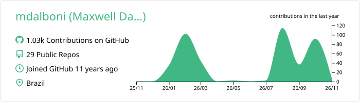
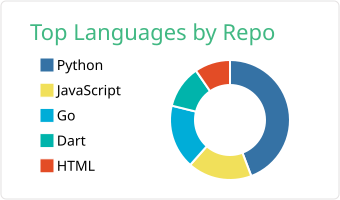
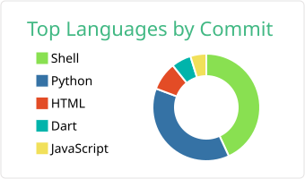
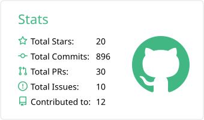
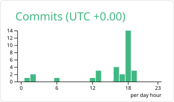

<!-- ponytail: static markdown profile. Max ceiling: GitHub profile summary. Upgrade path: add dynamic GH action feeds if blog/activity feed is requested. -->
# Maxwell M. Dalboni 👋

Senior Software Engineer focused on backend architecture, distributed systems, homelab infrastructure, and AI developer tooling. Building extensions and tooling for the **DeepSeek Harness (DSH)** ecosystem.

📍 Brazil &nbsp;|&nbsp; 🌐 [maxwell.dalboni.com.br](https://maxwell.dalboni.com.br) &nbsp;|&nbsp; 🖥️ [lab.dalboni.com.br](https://lab.dalboni.com.br)

---

### 🖥️ Homelab & Self-Hosting

- **Infrastructure:** Bare-metal Linux mini-cluster (`homelab-mini`) running 24/7.
- **Workloads:** Containerized microservices, local databases, automated backups, and developer platforms.
- **Networking & Security:** Private mesh via Tailscale, reverse proxies with automated SSL/TLS, and isolated environments.
- **AI Tooling Hub:** Self-hosting DeepSeek Harness (DSH) instances at `*.dalboni.com.br`.

---

### 🛠️ Core Stack & Focus

- **Languages:** Python, Go, TypeScript / JavaScript, SQL
- **Backend & Systems:** Distributed systems, microservices, gRPC, REST, asynchronous task queues
- **Infra & Storage:** Linux, Docker, PostgreSQL, Redis, Caddy/Nginx, Tailscale
- **AI Tooling:** DeepSeek Harness plugins, session orchestration, LLM developer ergonomics

---

### 🚀 Highlighted Work (DSH Ecosystem)

- [**dsh-spotlight**](https://github.com/mdalboni/dsh-spotlight) — Spotlight & IntelliJ-style fuzzy search dialog across DSH sessions, files, and chats.
- [**dsh-mobile**](https://github.com/mdalboni/dsh-mobile) — Mobile viewport lock, overscroll containment, virtual keyboard handling, and sidebar auto-retraction for DSH.
- [**dsh-static-token**](https://github.com/mdalboni/dsh-static-token) — Configurable static launch token authentication for DSH Web GUI deployments.
- [**dsh-turn-title**](https://github.com/mdalboni/dsh-turn-title) — Automatic turn titling after initial assistant exchanges with header action button.

---

### 📊 GitHub Activity

   
  
   
  
  

---

### 📫 Connect

- **Website:** [maxwell.dalboni.com.br](https://maxwell.dalboni.com.br)
- **Telegram:** [@mdalboni](https://t.me/mdalboni)
- **Email:** [maxwell@dalboni.com.br](mailto:maxwell@dalboni.com.br)
